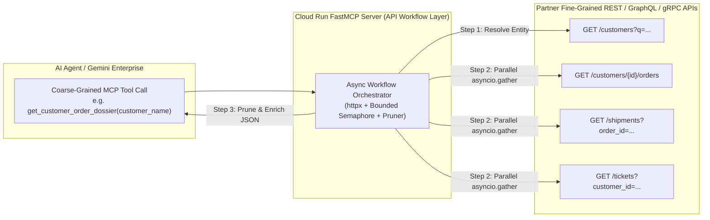

# API-to-MCP Wrapper & `stdio` Migrator Skill

Use this skill whenever a partner or developer wants to:
1. **Expose existing REST (OpenAPI/Swagger), GraphQL, or gRPC APIs as MCP tools** on Google Cloud Run—transforming fine-grained, chatty CRUD APIs into **coarse-grained business workflow tools** optimized for LLM reasoning.
2. **Migrate an existing local `stdio` MCP Server** (`npx` / `uvx` with static `ENV` API keys) into a **cloud-hosted, multi-tenant Enterprise MCP Server on Cloud Run** with **3-Legged OAuth 2.0** per-user token passthrough.

*(Companion Skills: Use [**Cloud Run MCP Server Creator**](../cloud_run_mcp_server_creator/SKILL.md) for the base FastMCP + OAuth 2.0 + Cloud Run deployment scaffolding, [**MCP Apps Developer**](../mcp_apps_developer/SKILL.md) to attach interactive `ui://` visual workflows, and [**Gemini Enterprise MCP Registrar**](../gemini_enterprise_mcp_registrar/SKILL.md) to register the server in Gemini Enterprise.)*

---

## Core Design Principles: Why 1:1 API-to-MCP Conversion Fails

When partners auto-generate MCP tools 1:1 from an OpenAPI/Swagger specification (e.g., exposing 80+ fine-grained `GET /v1/users/{id}`, `GET /v1/users/{id}/orders`, `POST /v1/orders/{id}/items` endpoints), **three critical problems** occur:
1. **Tool Selection Confusion:** LLMs degrade sharply when choosing among >20 overlapping fine-grained tools with similar parameter names.
2. **Multi-Turn Latency & Chatty Round-Trips:** To answer a single user question (*"Why is Acme Corp's latest order delayed?"*), the agent has to make 5 sequential tool calls (resolve customer ID $\rightarrow$ list orders $\rightarrow$ get order details $\rightarrow$ get shipment status $\rightarrow$ get support tickets), taking 30+ seconds.
3. **Context Window Overflow:** Raw REST APIs return verbose payloads (internal UUIDs, audit timestamps, base64 attachments, 500-item pages) that blow up token limits and cause hallucinations.

---

## The 5 API-to-MCP Consolidation Patterns

Always guide the partner to consolidate fine-grained APIs into **5 to 12 coarse-grained MCP workflow tools** using these patterns:

### Pattern 1: Entity Resolution + Parallel Fan-Out ("The 360° Dossier Tool")
* **Problem:** Users ask about human-readable names (*"Acme Corp"*, *"Project Titan"*), whereas REST APIs require internal UUIDs (`cust_98a7bc`) across 4 separate endpoints.
* **Solution:** Create a single tool (e.g., `get_customer_dossier(customer_name_or_id: str)`) that:
  1. Resolves the human name to an ID if a UUID wasn't provided.
  2. Uses `asyncio.gather` (with a bounded `asyncio.Semaphore(5)`) to fetch profile, recent orders, open tickets, and billing status concurrently.
  3. Returns one unified, pre-joined JSON document.

### Pattern 2: Enriched Search with Inline Previews (Eliminating N+1 Tool Calls)
* **Problem:** `GET /search` only returns `[ {"id": "101"}, {"id": "102"} ]`, forcing the LLM to call `get_details` 10 times in a loop.
* **Solution:** Inside `search_<domain>(query, filters, limit=10)`, automatically fan out and enrich the top `limit` results with title, status, key metrics, and a 200-character snippet so the LLM can answer immediately in 1 turn.

### Pattern 3: Server-Side Pagination, Aggregation & Analytics
* **Problem:** Fine-grained APIs return 20 items per page with a `next_page_token`. LLMs are terrible at paging through 10 pages to compute a sum or trend.
* **Solution:** Have the MCP tool fetch up to $N$ pages server-side, compute aggregations (counts by status, top categories, totals, min/max dates) in Python, and return both `summary_analytics` and the top matching records.

### Pattern 4: Intent-Driven Guarded Write Tools (Instead of Raw `PATCH`/`PUT`)
* **Problem:** Exposing a generic `update_record(id, payload_json)` is error-prone and dangerous.
* **Solution:** Expose explicit business-intent tools such as `approve_expense_report(report_id, comment)` or `escalate_support_ticket(ticket_id, priority, reason)` that:
  1. Verify preconditions via a GET call first.
  2. Construct the exact required REST payload server-side.
  3. Attach `WRITE_IDEMPOTENT_ANNOTATIONS` or `DESTRUCTIVE_ANNOTATIONS` (`destructiveHint=True`, `readOnlyHint=False`) so Gemini Enterprise prompts the user for confirmation before executing.

### Pattern 5: Context-Window Protection (`prune_payload_for_llm`)
* Always pass raw downstream API responses through a normalizer/pruner (included in [`resources/api_workflow_client_template.py`](./resources/api_workflow_client_template.py)) that:
  * Strips `null`/empty fields, internal system metadata, and base64/binary blobs.
  * Truncates overly long text fields (e.g., >1,500 chars) with a clean `...[truncated]` indicator.
  * Caps array lengths to a sensible maximum (e.g., top 25 items) while preserving `total_count`.

---

## Migrating Local `stdio` MCP Servers $\rightarrow$ Multi-Tenant Cloud Run

When a partner brings an existing local MCP server (e.g., `npx @partner/mcp-server` or `uvx partner-mcp` running over `stdio` with `os.environ["PARTNER_API_KEY"]`), follow this **4-step refactoring checklist**:

| Area | Local `stdio` Server (Before) | Enterprise Cloud Run Server (After) |
| :--- | :--- | :--- |
| **Transport** | `mcp.run(transport="stdio")` (Single local subprocess per user laptop) | Unified Starlette ASGI app (`StreamableHTTP /mcp` + `SSE /sse`) with `stateless_http=True` and `--session-affinity` on Cloud Run |
| **Host Security** | Default localhost binding | `TransportSecuritySettings(enable_dns_rebinding_protection=False, allowed_hosts=["*"])` |
| **Authentication** | Single static `os.environ["PARTNER_API_KEY"]` shared across all calls | **3-Legged OAuth 2.0** (`GoogleOAuthTokenVerifier` + `/authorize`, `/token`, `/register`) |
| **Downstream API Identity** | Hardcoded static API key header | **Per-User Token Passthrough (`get_current_user_token()`)** or Token Exchange per request (with fallback to Secret Manager key only for public/system endpoints) |
| **State Management** | Global in-memory variables (`current_session = ...`) | Stateless per-request context (`ContextVar`) or external store (Firestore / Memorystore / BigQuery) |

---

## Step-by-Step Workflow

### Step 1: Design Phase (Produce Tool Consolidation Plan & STOP)
When asked to design an API-to-MCP server or migrate a `stdio` server:
1. Inspect the partner's OpenAPI/Swagger spec, GraphQL schema, documentation, or existing `stdio` codebase.
2. Group the endpoints into **5–10 coarse-grained MCP workflow tools** using the 5 Consolidation Patterns above.
3. Present a clear **MCP Tool Design Table** (Tool Name, Business Intent, Input Parameters, Orchestrated Downstream Endpoints, Read/Write Annotations, Auth Mode) and **STOP** for user approval if they asked for a design first.

### Step 2: Scaffold Server & Async API Workflow Client
1. Scaffold the Cloud Run FastMCP server using [`../cloud_run_mcp_server_creator/resources/server_template.py`](../cloud_run_mcp_server_creator/resources/server_template.py).
2. Copy [`resources/api_workflow_client_template.py`](./resources/api_workflow_client_template.py) into `<MCP_SERVER_DIR>/services/api_client.py`.
3. Configure `DownstreamApiClient`:
   * Set `DOWNSTREAM_API_BASE_URL` (public SaaS URL or private PSC/VPC internal URL).
   * Pass `user_token_Getter=get_current_user_token` from `server.py` so every outbound API call automatically attaches the authenticated user's 3-Legged OAuth Bearer token (or falls back to `DOWNSTREAM_API_KEY` from Secret Manager).

### Step 3: Implement Coarse-Grained `@mcp.tool()` Functions
Implement each tool in `server.py` using:
* `api_client.request(...)` for single calls with automatic circuit-breaking and retries.
* `api_client.fan_out_gather(...)` for parallel multi-endpoint enrichment.
* `prune_payload_for_llm(...)` before `json.dumps(...)` so responses are compact and high-signal.

### Step 4: Local Smoke Test & Cloud Run Deployment
Test locally and deploy using [`../cloud_run_mcp_server_creator/scripts/deploy_cloud_run_mcp.sh`](../cloud_run_mcp_server_creator/scripts/deploy_cloud_run_mcp.sh) (adding `--use-secret-manager` and optional `--network`/`--subnet` for private VPC/PSC backends).
